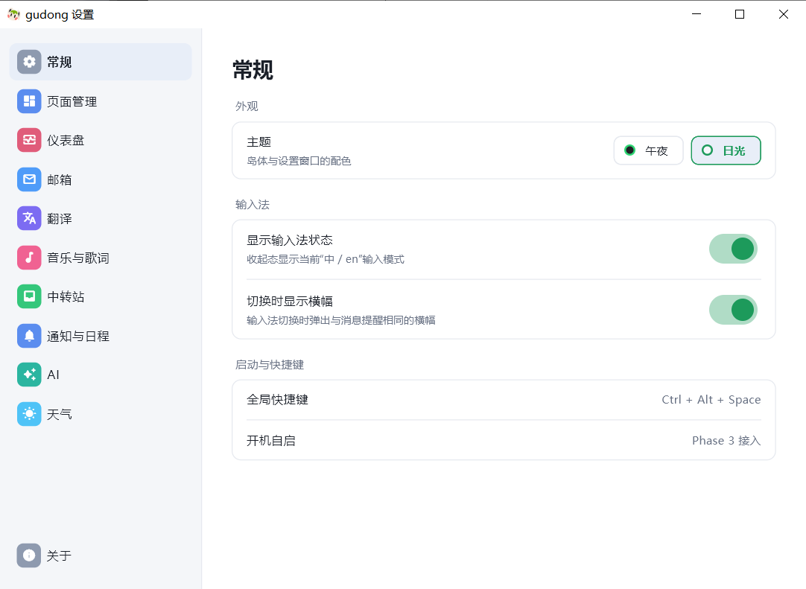

<div align="center">


# gudong

**Windows 桌面灵动岛：Flutter 负责岛体、动画与设置窗口，Rust sidecar 负责系统集成。**

[](LICENSE)
[](#-系统要求)
[](https://flutter.dev)
[](https://www.rust-lang.org)

</div>

<!-- 截图待补充：把图片放到 docs/images/ 后取消注释
<p align="center">
  
  <br/>
  <sub><b>收起态</b> —— 时间、天气、系统指标与未读提醒</sub>
</p>
<p align="center">
  
  <br/>
  <sub><b>展开态</b> —— 消息、邮件、天气、媒体与系统状态</sub>
</p>
<p align="center">
  
  <br/>
  <sub><b>设置</b> —— 页面管理、邮件、翻译、天气与外观</sub>
</p>
-->

## 为什么做这个

Windows 没有原生的灵动岛。把微信 / QQ 未读、邮件、天气、媒体播放、系统指标和 AI 额度收进屏幕顶部的一小块区域，需要时展开，不需要时安静待着。

gudong 用 Flutter 画岛体和动画，用 Rust sidecar 做系统集成，两端通过 stdio JSON-RPC 2.0 通信。系统检测和控制在 Rust，布局和交互在 Flutter，边界清晰。

## ✨ 特性

- **灵动岛交互** —— 透明、无边框、置顶、跳过任务栏；悬停展开、移出收起；逐像素点击穿透，岛外的点击直接落到下层窗口
- **消息提醒** —— 微信未读任务栏闪动；QQ 读取 Windows 通知正文显示联系人和内容；点击条目打开对应客户端
- **系统媒体（SMTC）** —— 封面、歌名、进度、当前歌词与播放控制；播放时收起态显示滚动音波
- **天气** —— 自动定位或手动搜索；实时天气、体感 / 湿度 / 风力、24 小时温度曲线与未来五天预报
- **邮件** —— IMAP 多账号、未读同步、账号筛选与邮件预览
- **多页面** —— 消息 / 邮件 / 翻译 / 天气 / 媒体 / AI 额度 / 诊断，可在设置中显隐和排序
- **翻译与额度** —— 多翻译服务切换；GLM、DeepSeek、OpenCode 等额度查询
- **托盘与快捷键** —— 托盘菜单显示 / 隐藏岛体，`Ctrl + Alt + Space` 展开 / 收起
- **性能预算** —— 空闲 private working set ≤ 80 MB，空闲 CPU ≤ 0.5%，冷启动 ≤ 1.5 s，动画 p95 < 16.7 ms

## 📦 下载安装

首个版本尚未发布，当前从源码构建。发布后会在这里和 [Releases](https://github.com/ldm0715/gudong/releases) 提供安装包。

## 🚀 快速开始

**环境要求**：Windows 10 2004+ / Windows 11，x64；Flutter stable（Dart 3.10+）；Rust stable；Visual Studio 2022 的 MSVC C++ 生成工具。

```powershell
git clone https://github.com/ldm0715/gudong.git
cd gudong

# 构建 Rust sidecar + Flutter release，并把 sidecar 复制到输出目录
powershell -ExecutionPolicy Bypass -File scripts\build.ps1

# 启动
island_app\build\windows\x64\runner\Release\island_app.exe
```

开发时分开跑：

```powershell
cd island_service
cargo build --release

cd ..\island_app
flutter run -d windows
```

快捷键 `Ctrl + Alt + Space` 展开 / 收起；托盘右键退出。

## 🧱 架构

- `island_app/` —— Flutter：岛体、动画、页面与设置窗口
- `island_service/` —— Rust：系统检测、采集、控制、网络、凭据与持久化
- `protocol/README.md` —— 两端之间的 stdio JSON-RPC 2.0 契约（`apiVersion = 1`）

规则很简单：Win32 / COM / UIA / 注册表 / 系统通知 / 进程 / 网络 → Rust；布局、动画、样式、交互 → Flutter。Flutter 不通过 FFI 或平台通道绕过 sidecar 直接读系统状态。

## 🔒 数据与隐私

- 配置与业务数据：`%APPDATA%\gudong`（`config.json`、`mail.json`、`schedule.json`、`anniversaries.json`、`shelf.json`）
- 日志：`%LOCALAPPDATA%\gudong\logs`，只写本地
- 翻译密钥、额度密钥与邮箱授权码保存在 **Windows 凭据管理器**（`gudong/...`），不写 `config.json`
- 无遥测、无日志上报
- 联网只用于：天气与定位、邮件 IMAP、翻译服务、AI 额度查询、歌词匹配和图片资源

## ⚠ 已知限制

- 微信 4.x 不写 Windows 通知中心，因此只能显示“有未读”，无法读取联系人和内容
- QQ 需要开启“新消息通知”才能显示预览
- Windows 10 没有 Mica，窗口材质与毛玻璃效果未实现
- 当前只有 x64 构建；ARM64 需要另外配置
- 仍在 Phase 2，接口和界面会继续调整；暂无自动更新与安装包

## 🛠 从源码构建

```powershell
# 两端一起构建并复制 sidecar
powershell -ExecutionPolicy Bypass -File scripts\build.ps1

# 只改 Flutter
cd island_app
flutter analyze
flutter test

# 只改 Rust
cd island_service
cargo build --release
cargo test
```

性能基线（需先退出应用）：

```powershell
powershell -ExecutionPolicy Bypass -File scripts\measure-baseline.ps1
```

## 📁 项目结构

```text
island_app/          Flutter 客户端
island_service/      Rust sidecar
protocol/            JSON-RPC 协议文档
docs/                阶段报告与执行计划
scripts/             构建、性能基线脚本
```

## 非官方声明

本项目为个人学习用途，与腾讯 / 微信 / QQ、邮件服务商及任何 AI 服务商无关联。程序只读取本机通知和用户主动配置的账号，不绕过任何权限，也不分发第三方客户端资源。

## 📄 许可证

gudong 以 [AGPL-3.0](LICENSE) 协议开源，© 2026 gcnanmu。

分发修改后的版本，或通过网络向他人提供本项目时，需要按 AGPL-3.0 提供对应源码。

## 依赖与致谢

| 项目 | 用途 | 许可 |
| --- | --- | --- |
| [Flutter](https://flutter.dev) | 岛体、动画与设置窗口 | BSD-3-Clause |
| [Rust](https://www.rust-lang.org) / [windows-rs](https://github.com/microsoft/windows-rs) | sidecar 与 Win32 / COM 集成 | MIT / Apache-2.0 |
| [window_manager](https://pub.dev/packages/window_manager) | 窗口透明、置顶与拖动 | MIT |
| [tray_manager](https://pub.dev/packages/tray_manager) | 托盘图标与菜单 | MIT |
| [hotkey_manager](https://pub.dev/packages/hotkey_manager) | 全局快捷键 | MIT |
| [desktop_multi_window](https://pub.dev/packages/desktop_multi_window) | 独立设置窗口 | MIT |
| [flutter_svg](https://pub.dev/packages/flutter_svg) / [font_awesome_flutter](https://pub.dev/packages/font_awesome_flutter) | 图标资源 | MIT |
| [imap](https://crates.io/crates/imap) / [mailparse](https://crates.io/crates/mailparse) | 邮件收取与解析 | MIT |
| [Open-Meteo](https://open-meteo.com) / [wttr.in](https://wttr.in) | 天气与地理编码 | 各自服务条款 |

完整依赖见 [`island_app/pubspec.yaml`](island_app/pubspec.yaml) 与 [`island_service/Cargo.toml`](island_service/Cargo.toml)。

---

更多设计文档见 [`docs/`](docs/)，协议细节见 [`protocol/README.md`](protocol/README.md)。
